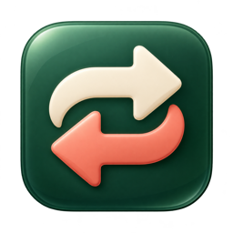
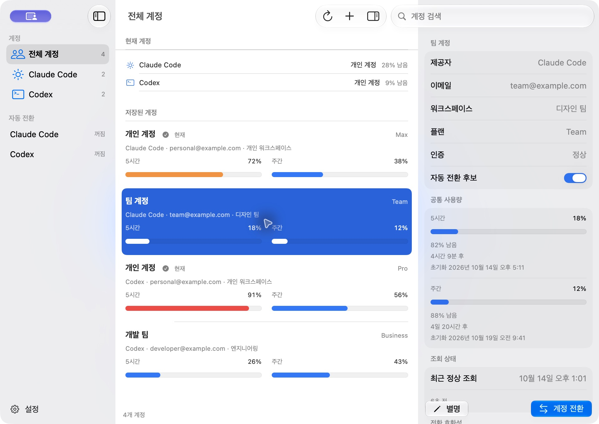

# AgentSwap

Claude Desktop의 계정별 프로필과 Claude Code CLI·Codex의 여러 구독 계정을 관리하는 macOS 네이티브 앱입니다. Swift 6·SwiftUI·AppKit으로 작성했습니다.

**현재 개발·검증 중이며 v1 완료 상태가 아닙니다.** 이전 Desktop 2.42304.0의 명시적 결합 전환에서는 두 계정 왕복과 기존 Code 대화의 새 응답을 확인했습니다. 새 Desktop 3.1623.0의 독립 프로필은 실제 두 계정 로그인·Code 요청·장시간 유지 검증이 남아 있으며, Codex의 서로 다른 계정 전환·데스크톱 재실행 검증도 미완료입니다.



위 화면의 계정과 사용량은 데모 데이터입니다. [다크 모드 화면](docs/screenshots/dashboard-dark.png)도 확인할 수 있습니다.

## 주요 기능

- 제공자 필터·검색·계정별 별명·워크스페이스·플랜·현재 계정 표시
- Claude Desktop의 계정별 로그인 프로필, 정상 종료 후 프로필 전환·재실행, 기존 Desktop으로 복귀
- 공통·모델별 사용 창, 잔여율, 초기화 시각, 크레딧과 추가 한도 표시
- 현재 CLI 로그인 가져오기와 격리된 공식 CLI·브라우저 로그인
- 수동 전환과 제공자별 자동 전환, 실행 중인 Codex의 재실행 대기
- 대시보드·메뉴바·설정이 공유하는 상태와 조회 스케줄러
- 라이트·다크 모드, macOS 26 이상의 Liquid Glass, 이전 OS의 표준 시스템 UI
- 창을 닫아도 계속 실행되는 메뉴바와 `SMAppService` 로그인 시 실행 설정
- GitHub Releases의 서명된 업데이트 확인과 Sparkle의 설치·재실행 안내

앱과 관리 엔진은 Swift로 작성했습니다. 공식 Claude Code·Codex CLI는 로그인 절차에만 호출하고, 사용량과 토큰 갱신은 API 어댑터에서 직접 처리합니다. Claude 네이티브 Keychain 저장에는 별도로 Apple의 `/usr/bin/security`를 사용합니다.

## 요구사항

| 구분 | 요구사항 |
|---|---|
| 앱 실행 | macOS 14 이상 |
| 앱 빌드 | macOS 27 SDK를 포함한 Xcode 27 이상, Swift 6 |
| 새 계정 로그인 | 해당 제공자의 공식 CLI와 구독 계정 |
| 큰 Claude 인증 저장 | Apple Command Line Tools 또는 Xcode의 Swift·macOS SDK |
| 지원 프로필 | 기본 로컬 프로필의 구독 로그인 |

앱의 업데이트에는 Sparkle 2.10.0을 사용합니다. 실제 검증 환경과 설치 버전은 [검증 기록](docs/VALIDATION.md)에 정리했습니다.

## 빌드와 테스트

저장소 루트에서 실행합니다. Xcode를 다른 위치에 설치했다면 `DEVELOPER_DIR`를 해당 경로로 지정하세요.

```sh
export DEVELOPER_DIR="/Applications/Xcode.app/Contents/Developer"

./scripts/test-core.sh
./scripts/build-app.sh
codesign --verify --deep --strict build/AgentSwap.app
open build/AgentSwap.app
```

테스트 스크립트는 Xcode의 Swift와 native SwiftPM을 사용하며, `build/CoreTests`에 별도 빌드 캐시를 둡니다. 인증·파일·네트워크·프로세스 검증에는 fixture와 주입한 저장소를 사용합니다.

앱 빌드는 현재 머신의 아키텍처에 맞는 Release를 만듭니다. 기본 서명은 ad-hoc이며 `AGENTSWAP_SIGN_IDENTITY`로 서명 ID를 지정할 수 있습니다. `AgentSwap.xcodeproj`를 열고 공유된 `AgentSwap` 스킴을 실행해도 됩니다. 앱 번들 ID는 **`net.mercen.agentswap`**이며 샌드박스는 사용하지 않습니다.

실행 중인 `build/AgentSwap.app`은 덮어쓰지 않습니다. 스크립트는 새 결과를 DerivedData에 준비하고, 앱을 종료한 뒤 다시 실행하면 기본 경로에 설치합니다. 스크립트가 빌드할 DerivedData 복사본 자체가 실행 중이면 먼저 종료해야 합니다.

### 데모 실행

앱을 종료한 뒤 합성 데이터 모드로 실행할 수 있습니다.

```sh
open build/AgentSwap.app --args --demo
```

데모 계정은 메모리에만 보관하며 실제 인증 저장소·Keychain·사용량 API에 접근하지 않습니다. 실제 계정으로 돌아가려면 데모 앱을 종료하고 일반 모드로 다시 실행하세요.

## 개발용 초안 릴리스

릴리스 담당자가 `v0.1.0` 또는 `v0.1.0-beta.1` 형태의 버전 태그를 원격 저장소에 push하면 [릴리스 워크플로](.github/workflows/release.yml)가 Core 테스트와 Universal Release 패키징을 실행합니다. `arm64`·`x86_64`를 포함한 앱 ZIP·`SHA256SUMS`·Sparkle `appcast.xml`이 GitHub 릴리스 초안에 첨부됩니다. beta.8부터 앱은 고정된 전용 인증서로 서명하며, 인증서가 없거나 일치하지 않으면 릴리스를 중단합니다. 태그에 사전 버전 접미사가 있으면 prerelease로 표시하며, 업데이트 ZIP은 별도의 EdDSA 키로 서명합니다.

워크플로는 태그를 만들거나 릴리스를 자동 공개하지 않습니다. 담당자가 GitHub의 Releases에서 초안·릴리스 노트·산출물을 검토한 뒤 공개 여부를 결정합니다. 태그의 숫자 기본 버전은 앱 버전에, 소스 커밋의 Unix 시각은 빌드 번호에 사용합니다.

같은 패키징을 로컬에서 실행할 수 있습니다.

```sh
./scripts/package-release.sh 0.1.0
```

결과는 `build/releases/0.1.0/AgentSwap-0.1.0-universal.zip`과 같은 폴더의 `SHA256SUMS`·서명된 `appcast.xml`입니다. 기존 버전 폴더나 같은 태그의 릴리스 초안은 덮어쓰지 않습니다. 자세한 버전 규칙과 검토 절차는 [기여 안내](CONTRIBUTING.md)를 참고하세요.

이 ZIP은 macOS 14 이상을 대상으로 하는 개발용 앱입니다. 전용 self-signed 인증서는 업데이트 사이의 Keychain 앱 식별을 유지하기 위한 것이며 Developer ID 서명·Apple 공증·DMG를 포함하지 않습니다. Gatekeeper의 확인된 개발자·공증 검증을 대신하지 않으므로, 다운로드한 앱을 열 때 macOS가 경고하거나 실행을 차단할 수 있습니다. [Apple의 Gatekeeper 안내](https://support.apple.com/ko-kr/102445)

## 앱 업데이트

beta.6부터 앱이 GitHub Releases에서 새 버전을 확인합니다. **업데이트 확인**으로 직접 조회하거나 기본 24시간 간격의 자동 확인을 사용할 수 있습니다. 자동 다운로드·설치는 기본으로 꺼져 있으며, 설치와 앱 재실행은 Sparkle의 안내에서 사용자가 선택합니다. AgentSwap은 재실행 전에 진행 중인 인증 저장과 복구 상태 저장을 기다립니다.

베타 앱은 공개된 베타 릴리스를 포함해 확인하고 정식 버전 앱은 정식 릴리스만 확인합니다. draft와 업데이트 자료가 완성되지 않은 릴리스는 제외합니다. 앱에 포함된 공개키로 서명된 ZIP을 검증한 뒤 설치하며, 업데이트 피드와 ZIP은 GitHub Release 첨부 파일을 사용합니다. 이 업데이트 서명은 Developer ID 서명·Apple 공증과 별개입니다. 데모 모드에서는 업데이트 네트워크 요청을 시작하지 않습니다.

beta.5 이하에는 업데이트 기능이 없으므로 beta.6을 한 번 직접 내려받아 설치해야 합니다. 이후 릴리스부터 앱 안에서 업데이트할 수 있습니다. 서명 키와 릴리스 생성 절차는 [기여 안내](CONTRIBUTING.md)를 참고하세요.

제공자 표시는 Simple Icons의 Claude 마크·브랜드 색상과 공식 OpenAI 자산을 사용합니다. 앱 아이콘은 AgentSwap 전용 디자인입니다. 출처·라이선스·아이콘 생성 프롬프트는 [브랜드 자산 안내](docs/BRAND_ASSETS.md)에 기록했습니다.

## 사용 방법

**Claude Desktop 3.1623.0의 Code 탭**을 사용한다면 왼쪽 **Claude Desktop**을 선택합니다. **Desktop 프로필 추가**에서 계정별 이름을 정하고, **전환 및 재실행**을 누른 뒤 열린 공식 Desktop에서 처음 한 번 로그인합니다. 이후 같은 프로필의 로그인·대화 저장과 인증 갱신은 Desktop이 담당합니다. **기존 Desktop 열기**는 원래 로그인과 Code 대화가 있는 기본 프로필로 돌아갑니다. 메뉴바에서도 프로필을 열 수 있습니다.

Desktop 프로필은 CLI 계정과 별도로 등록하며 CLI OAuth를 Desktop 로그인으로 변환하지 않습니다. 새 프로필은 별도 Code 대화 목록을 사용하며 기존 대화의 계정 간 이어쓰기를 보장하지 않습니다. 프로필을 전환하기 전에 진행 중인 작업을 저장하세요. 정상 종료가 거부되거나 관련 프로세스가 남으면 전환을 중단합니다. 알 수 없는 Desktop 버전에서는 새 프로필 실행을 허용하지 않습니다.

**Claude Code CLI·Codex**는 왼쪽 **CLI·Codex 계정**에서 관리합니다.

1. 대시보드의 **계정 추가**에서 제공자를 선택합니다. **현재 CLI 로그인 가져오기**는 기존 인증을 등록하고, **새 계정에 로그인**은 격리된 임시 프로필에서 브라우저 로그인을 진행합니다. 같은 계정을 다시 등록하면 별명과 후보 설정을 유지하며 인증을 갱신합니다.
2. Claude 브라우저가 코드를 표시하면 **브라우저 인증 코드**에 `코드#state` 전체를 붙여넣고 **코드 제출**을 누릅니다. 제출한 코드는 입력란에서 지우며 설정이나 로그에 저장하지 않습니다.
3. 목록에서 계정을 선택해 사용량·조회 상태를 확인하고 **계정 전환**을 누릅니다. Codex 소비 프로세스가 실행 중이면 전환을 대기합니다. 별도 CLI·IDE를 종료한 뒤 **전환 및 재실행**으로 정상 종료 확인·최신 인증 백업·교체·데스크톱 재실행을 진행합니다.
4. 자동 전환을 사용하려면 계정의 **자동 전환 후보**를 체크하고, 설정에서 제공자별 자동 전환을 켭니다. 기본값은 꺼짐입니다.

이전 Desktop 2.42304.0에서 CLI와 Desktop 로그인을 함께 바꾸려면 각 계정으로 Desktop에 로그인한 뒤 계정 상세의 **이 계정의 Desktop 로그인 저장**을 한 번씩 실행합니다. 이후 **Desktop과 CLI 함께 전환**은 Desktop을 정상 종료하고 저장된 로그인 및 기존 Code 대화 목록을 적용한 뒤 다시 엽니다. Desktop 로그인 백업과 복구 자료는 Keychain에 보관하며 대화 원본은 유지합니다. 현재 Desktop **2.42304.0**만 지원하는 실험적 로컬 연동이며, 일반 Chat·Cowork·클라우드 대화 이전은 포함하지 않습니다.

자동 전환의 기본 임계치는 90%입니다. 후보의 공통 사용 창에서 가장 적게 남은 잔여율을 비교하며, 최소 5%p 개선이 있을 때 전환합니다. 전환 뒤 5분 동안 유예하고, 오래되거나 실패한 조회·인증 오류·불완전한 한도는 후보에서 제외합니다. 모델별 부가 한도는 표시만 합니다.

전환이 비활성화되면 버튼 부근의 이유와 **전환 호환성**을 확인하세요. **전환 호환성 다시 확인**은 저장소 접근만 다시 검사하며 계정을 전환하지 않습니다. 권한·저장 상태가 바뀌면 조회 완료 뒤에도 호환성을 갱신합니다.

새 로그인의 브라우저 자동 열기는 공식 CLI가 담당합니다. 브라우저가 열리지 않았을 때만 **로그인 페이지 다시 열기**를 누르세요. 수동 페이지가 코드를 표시하면 `코드#state` 전체를 제출합니다.

활성 계정은 기본 3분, 비활성 계정은 10분마다 조회합니다. 실패해도 마지막 정상 값을 유지하고 오류를 표시하며, 수동 새로고침도 서버의 `Retry-After`를 존중합니다. 초기화 시각은 절대 시각으로 저장하고 시스템 시간대로 표시합니다.

## 인증과 데이터 보관

| 데이터 | 저장 위치 |
|---|---|
| 계정 인증 | macOS Keychain 서비스 `net.mercen.agentswap` |
| 전환·토큰 갱신 복구 자료 | macOS Keychain 서비스 `net.mercen.agentswap.recovery` |
| 계정 메타데이터·설정·사용량 캐시 | `~/Library/Application Support/AgentSwap/state.json` |
| 명시적 Desktop 결합 전환의 로그인 스냅샷 | macOS Keychain 서비스 `net.mercen.agentswap.desktop` |
| 독립 Desktop 프로필 이름·UUID | `~/Library/Application Support/AgentSwap/ClaudeDesktopProfiles/profiles.json` |
| 독립 Desktop 프로필의 로그인·대화 | 같은 경로의 UUID별 private 폴더에서 공식 Desktop이 관리 |

macOS Keychain 접근 요청은 사용자가 승인합니다. 제공자의 인증과 앱에 저장한 인증은 별도 항목입니다. beta.7 이하의 ad-hoc 앱에서 beta.8의 고정 서명으로 옮길 때는 기존 항목의 승인이 한 번 필요할 수 있습니다. **AgentSwap 메뉴 → 저장된 계정 접근 허용…**으로 저장된 계정의 접근을 차례로 확인하거나, 계정 상세의 **저장된 인증 접근 허용**으로 한 항목만 확인하세요. macOS 승인 창은 사용자가 직접 처리합니다. 실패·취소하면 일괄 확인을 멈춥니다. 이 동작은 저장된 인증을 읽으며 재로그인·계정 전환은 하지 않습니다. 승인 성공 후 해당 계정의 저장소 오류 대기는 해제하고, 서버의 요청 한도 대기는 유지합니다. 이후 새로고침하거나 다음 조회를 기다리세요.

토큰과 인증 코드는 메타데이터나 로그에 기록하지 않습니다. Claude의 인증과 `oauthAccount`를 함께 바꾸고 MCP·플러그인 인증과 계정 외 설정을 보존합니다. Codex의 설정·세션·대화 기록도 유지합니다. 알 수 없는 저장 형식에서는 쓰기를 중단합니다.

Claude 네이티브 Keychain의 작은 인증은 macOS 저장 도구의 hex 표준 입력을 사용합니다. 큰 인증은 Apple 서명을 검증한 Swift 인터프리터에서 번들 Swift 코드로 저장하고, 인증은 표준 입력으로만 전달합니다. 저장 후 별도의 macOS 도구가 정확한 바이트를 읽는지 확인합니다. 비밀 값을 명령 인자에 넣지 않습니다. 앱 vault·복구 자료·Codex는 Swift Security 저장소를 사용합니다. 네이티브 도구의 백그라운드 접근은 잠금 사전 확인과 시간 제한을 사용하지만 승인 창 자체가 나타나지 않는다고 보장하지는 않습니다. macOS 암호를 앱에서 수집하지 않습니다.

확인된 토큰 갱신 응답을 처음 저장하지 못하면 새 인증을 메모리에 보존하고 다음 작업 전에 재시도합니다. 정상 종료는 진행 중인 작업과 저장을 기다리며, 저장 실패 시 종료를 보류합니다. 첫 영구 저장 이전에 강제 종료되거나 시스템이 중단되면 메모리의 새 토큰을 복구할 수 없습니다.

계정을 삭제하면 앱의 인증과 캐시가 삭제됩니다. 제공자의 구독과 현재 CLI 로그인은 유지됩니다. 자세한 저장·복구 조건은 [구조 문서](docs/ARCHITECTURE.md)를 참고하세요.

## 지원 상태와 제한

| 제공자 | 구현 범위 | 실제 검증 상태 |
|---|---|---|
| Claude Desktop 독립 프로필 | 계정별 네이티브 데이터 폴더, 정상 종료·재실행, 기본 프로필 복귀 | 3.1623.0의 정적 코드 조사와 합성 fixture. 실제 두 계정 로그인·Code 요청·장시간 유지 미완료 |
| Claude Code·Desktop 결합 | Keychain OAuth·계정 메타데이터 전환, 직접 사용량 조회·갱신, 명시적 Desktop 결합 전환 | Desktop 2.42304.0에서 서로 다른 두 계정의 CLI·Desktop 왕복과 기존 로컬 Code 대화의 새 응답 확인 |
| Codex | `file`·`keyring`·`auto`, 직접 사용량 조회, 소비 프로세스 확인·정상 종료·재실행 | 현재 로그인 가져오기와 API 조회 확인. 서로 다른 계정 전환·데스크톱 재실행 후 로그인 검증은 대기 |

- Codex의 `auto`는 Keychain을 우선합니다. `ephemeral`, 별도 secrets 백엔드, 관리 정책과 알 수 없는 형식은 감지 후 쓰기를 중단합니다.
- Claude CLI 인증과 Claude 데스크톱 로그인은 별개입니다. 일반·자동 전환은 기존 Code 대화 파일과 목록에 손대지 않고 인증만 바꿉니다. 명시적인 **Desktop과 CLI 함께 전환**만 Desktop 로그인과 로컬 Code 목록을 적용하며, 실행 중 원격 연결은 이전하지 않습니다.
- 독립 Desktop 프로필은 3.1623.0의 Electron `--user-data-dir`로 분리하며, 2.42304.0의 로그인 스냅샷 결합 전환과 다른 기능입니다. 데이터 폴더 변경 시 Claude in Chrome의 로컬 연결이 제한되며, 일부 CLI 설정·transcript는 공용 `~/.claude`를 사용할 수 있습니다. 전체 파일 격리나 기존 대화의 계정 간 이전으로 표시하지 않습니다.
- 일반·자동 전환은 로컬 Code 형식이나 Desktop 버전을 검사하지 않습니다. 명시적 결합 전환은 지원 버전과 저장된 Desktop 로그인이 필요합니다. 계정 상세의 **대화 이어가기**에서 공식 재개 방법을 확인할 수 있습니다. 이전 버전이 남긴 미완료 대화 보존 저널은 계속 전환을 차단하며, 별도의 **중단된 대화 목록 복구**로 처리합니다.
- 대시보드 하단 상태바의 긴 메시지는 정보 버튼을 눌러 전체 내용을 읽고 복사할 수 있습니다. 전환 결과나 안내가 표시되어도 상태바 높이는 유지됩니다.
- Claude 인증은 공유 MCP·플러그인 자료를 보존하며, 대상과 복원 자료 모두 Claude CLI의 읽기 출력 한도(1,000,000바이트)를 사전 검사합니다. ASCII 인증은 999,999바이트, hex 출력이 필요한 기존 인증은 499,999바이트까지 지원합니다. 기존 명령 길이를 넘는 인증에는 Apple Command Line Tools 또는 Xcode가 필요합니다. 도구·SDK가 없거나 검증에 실패하면 원본을 유지하고 전환 호환성에 이유를 표시합니다.
- API 키, 프로젝트별 계정 실행, 클라우드 동기화, 인증 내보내기는 지원 범위에서 제외합니다.
- macOS 14·15에서의 실제 실행, 메뉴바에서 실제 계정 전환, 로그인 시 실행 후 재로그인 검증은 남아 있습니다.
- 초안 릴리스의 개발용 ZIP에는 Developer ID 서명·공증·DMG를 포함하지 않습니다.

테스트·빌드 통과와 실제 계정 검증은 구분합니다. 최신 범위와 남은 완료 조건은 [검증 기록](docs/VALIDATION.md)을 확인하세요.

## 저장소 구조

| 경로 | 역할 |
|---|---|
| `AgentSwap.xcodeproj/` | macOS 앱 타깃과 공유 스킴 |
| `AgentSwapApp/` | SwiftUI 화면·AppKit 생명주기·아이콘 |
| `AgentSwapCore/Sources/AgentSwapCore/` | 모델·제공자 어댑터·저장소·자동 전환 엔진 |
| `AgentSwapCore/Tests/AgentSwapCoreTests/` | 주입한 저장소와 합성 응답을 사용하는 테스트 |
| `scripts/` | 앱 빌드·엔진 테스트·Universal ZIP 패키징·아이콘 재생성 |
| `.github/workflows/` | CI와 태그 기반 초안 릴리스 |
| `docs/` | 구조·디자인·검증 기록과 데모 화면 |
| [AGENTS.md](AGENTS.md) | 코딩 에이전트의 저장소 작업 규칙 |
| [agentswap-dev 스킬](.agents/skills/agentswap-dev/SKILL.md) | 프로젝트 전용 개발·검증 절차 |

아이콘 원본과 프롬프트는 `AgentSwapApp/Assets/`에 있습니다. `scripts/generate-icon.swift`는 저장된 원본에서 macOS 아이콘 크기를 재생성하며 이미지 모델을 다시 호출하지 않습니다.

## 기여와 문서

[기여 안내](CONTRIBUTING.md)를 먼저 읽어주세요. 제공자 형식·토큰 갱신·전환 동작을 바꿀 때는 해당 실패 경계를 fixture로 검증하고, 실제 인증 검증과 구분해 기록합니다. 이슈·PR·화면 기록에는 토큰, 인증 파일, 개인 계정 정보나 실제 대화 내용을 포함하지 마세요.

AI 에이전트를 사용할 때는 [AGENTS.md](AGENTS.md)와 [프로젝트 전용 스킬](.agents/skills/agentswap-dev/SKILL.md)을 먼저 확인하세요.

- [구조와 안전 조건](docs/ARCHITECTURE.md)
- [네이티브 UI와 Liquid Glass](docs/DESIGN.md)
- [검증 범위와 남은 조건](docs/VALIDATION.md)
- [Claude 전환 참고: ccswap 지정 커밋](https://github.com/errhythm/ccswap/blob/1138fa70cabde9c85a2a42b6c6d9863f93e3b778/src/claude_swap/switcher.py)
- [Codex 인증 문서](https://learn.chatgpt.com/docs/auth)
- [Apple MenuBarExtra](https://developer.apple.com/documentation/swiftui/menubarextra)
